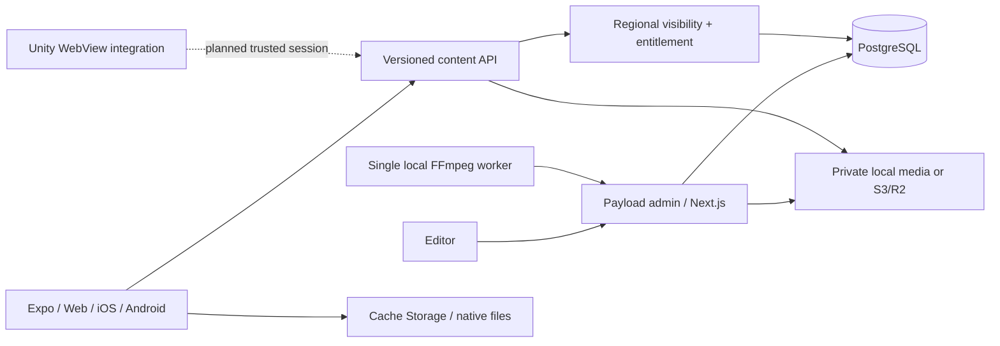

# Architecture

## Boundaries and models

Payload owns Users, Media, Tags, Stories and Homes. Ordered page arrays carry stable row IDs; localization arrays explicitly associate text, narration and timing for one language. Payload locales localize tag labels. The shared Zod manifest validates page IDs, token offsets, timing bounds, media type/readiness and content shape before publication. An incomplete language is not exposed by the public API; attempting to publish it produces a language/page validation error.

Stories contain structured age bounds, tag relations, access defaults, cover fallback, updatedAt timestamp, editable publication timestamp, pages and story music. Page records contain illustration/video/poster fallback, text layouts, narration/delay/timings, music override, effects, and transitions. Timing offsets reference the **original UTF-16 string**, preserving punctuation, whitespace and line breaks; a timing token can be any language-appropriate text span. The player searches timings against actual audio position.

Every story save advances its server-managed updatedAt timestamp; clients compare that timestamp to detect updates. There is no numeric content-version counter. Payload still retains 30 history snapshots. Uploaded media has a SHA-256 hash and immutable contents: an editor must upload a new asset to change content. This makes versioned delivery deterministic. A worker may finish processing an unpublished pending asset. Saving a published story as Draft currently unpublishes it; there is no separate live snapshot plus unpublished working revision.

## API and access

All client paths call the shared access resolver. Visibility, access level and Premium entitlement are independent. Matching country/channel variants sort by descending priority then stable ID; a matching region takes precedence over global fallback. Included/excluded stories and language readiness are applied before age/tag filters and pagination. Exclusions apply even to Premium readers. Preview metadata contains only a cover and metadata, never narration/video URLs.

The server resolves country and DISTRIBUTION_CHANNEL from deployment configuration. Development parent controls request a signed 30-minute session for testing country/channel/Premium. DEV_COUNTRY/DEV_PREMIUM are also honored only in development. Production has no subscription validator and therefore grants Free access only. A future server session must supply verified country/channel/entitlement; request query parameters cannot elevate access.

Raw Payload collections and media require an admin. The delivery endpoint authorizes membership in a playable manifest (or the public cover), validates the asset hash, then serves a local file with Range support or a short-lived S3 signed redirect. CORS is restricted to CLIENT_ORIGIN. Rate limiting currently caps aggregate process traffic, not distributed per-client traffic. Production requires gateway limits, trusted proxy configuration, storage CORS, backups and HTTPS.

## Player

The React Native player shares Expo Image, Video and Audio across targets. Narration, music and effects have separate players. Page replacement unmounts narration/video and disposes effects. Animation replay resets animation cues only; Read Again seeks narration only. Music stays mounted across pages when its asset is unchanged, with volume ducking, fade-in and exit fade-out. Text supports below-image and readable overlay layouts; effects respect optional duration. App backgrounding pauses playback; resuming is explicit. Bluetooth/interruption behavior still needs device validation.

## Downloads

AssetStore abstracts Cache Storage and Expo FileSystem. Downloads persist their manifest and incremental state by story/language/update timestamp, verify size/hash, and mark complete only after every required asset is stored. Interrupted operations become recoverable errors on restart. Requests are deduplicated; full-story downloads are serialized to protect their manifest index. Failed updates preserve the last verified version. Successful updates and deletion remove unreferenced old assets while retaining shared assets. A bounded preload cache and retryable garbage-collection queue remain work.

Web resolves cached files to Blob URLs so browser media seeking works without a custom Range service worker. The service worker stores the app shell. Browser eviction is detected by revalidation. Native uses document storage and SHA-256 verification; native behavior is not device-tested. Opening verifies the current page illustration and narration before playback. Preloading orders current page, next two, then remaining pages with two fetches in flight; fine-grained video decode readiness remains work.

Premium offline manifests have a one-day development expiry. Signed offline licenses, trustworthy clock/revocation handling and entitlement revalidation require the future subscription backend. Downloadable media is not DRM. Online authorization errors are never bypassed with an offline fallback; only transport failures permit it.

## Media and future integrations

Local uploads live in apps/cms/media. Original audio/video uploads are copied into media/originals before a separate FFmpeg worker produces H.264, yuv420p, faststart, narration-free MP4 or normalized WAV. It extracts duration, generates a selectable video poster and updates the delivery hash before marking ready. Temporary jobs live outside delivery storage. It processes one queue at a time with a timeout; production needs leases/retries and object-storage staging. Payload generates image thumbnails. TTS/alignment providers are interfaces only; seed narration uses local eSpeak NG or optional Windows System.Speech with word events.

Parent identities, child profiles and learning events have small domain interfaces. Local guest IDs own Favorites/progress/completion. Future migration should explicitly attach that guest data to a consenting parent's child profile. There is no cloud child data or analytics. Unity has message schemas and a C# integration sample, with the trusted session exchange specified separately; no existing app verifier is available.
